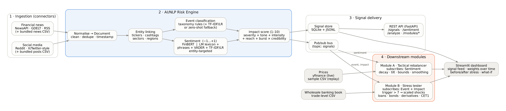
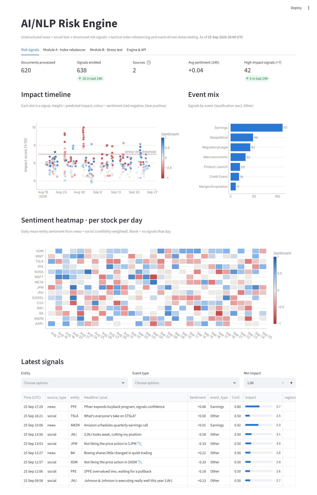
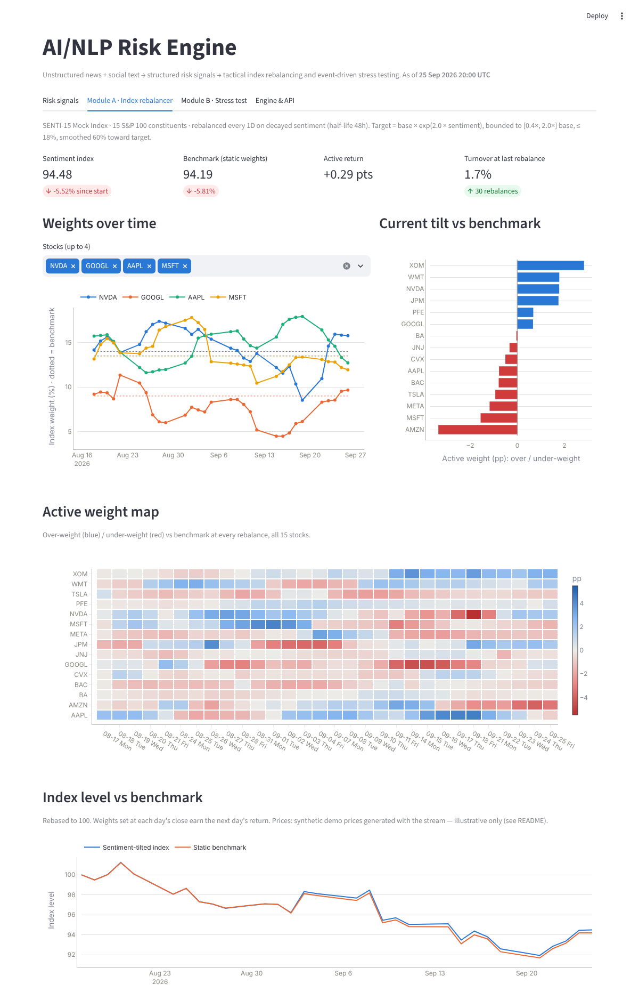
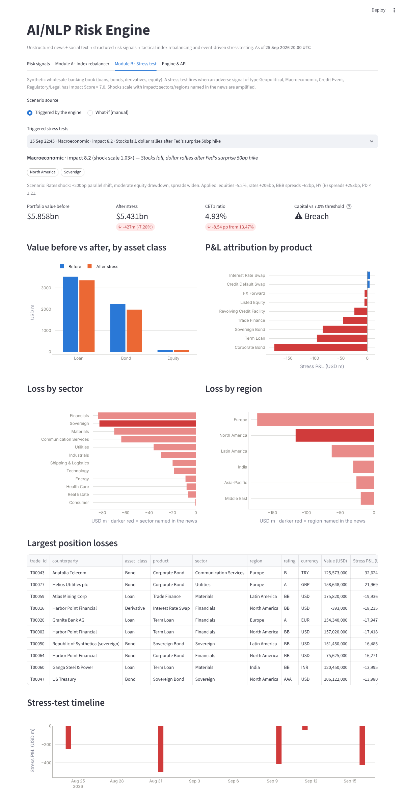
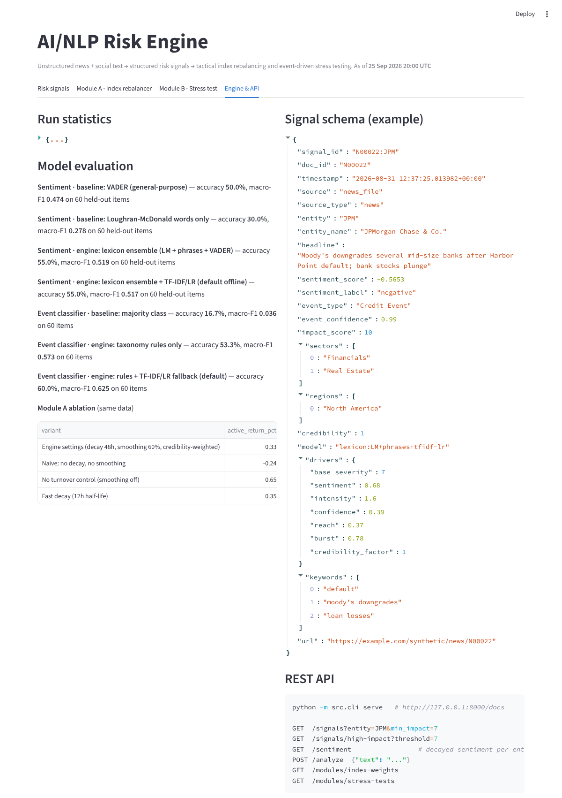

# SENTINEL: AI/NLP Risk Engine - S&P Global & Crisil Campus Hackathon

**Candidate Name:** Goureesankar S Nair

**College Email ID:** goureesankar.snair2023@vitstudent.ac.in

**College / Campus:** Vellore Institute of Technology (VIT), Vellore

**Demo Video Link:** [https://youtu.be/LbYbk2UM2AU](https://youtu.be/LbYbk2UM2AU)


---

## 1. Project Overview / Problem Statement & Approach

Markets react to words before they react to numbers: a tanker attack in the Strait of Hormuz, a regional
lender missing a coupon, a hotter-than-expected inflation print. Risk teams need those words turned into
**structured, machine-readable signals** fast enough to act on, whether that means tilting an index or
stress-testing a banking book.

**SENTINEL** is a unified AI/NLP Risk Engine that ingests unstructured text from **two kinds of source**
(financial news and social media) and emits one structured `RiskSignal` per entity mentioned:
a **Sentiment Score** (−1…+1), an **Event Classification** (Geopolitical, Macroeconomic, Credit Event,
Merger/Acquisition, Product Launch, Earnings, Regulatory/Legal, Other), and an **Impact Score** (1–10). Every
score is explainable: the impact score comes with its additive decomposition (`drivers`) and the event label
comes with the keywords that triggered it. Signals are persisted (SQLite + JSONL), published on an in-process
pub/sub bus, and served through a REST API.

Both downstream modules are implemented:

- **Module A: tactical index rebalancer.** It subscribes to the sentiment stream and rebalances a 15-stock
  mock S&P 100 index. Stocks with positive sentiment are overweighted and stocks with negative sentiment are
  underweighted, using exponential time decay, credibility weighting, position bounds and turnover smoothing.
- **Module B: strategic stress tester.** It subscribes to event and impact signals. When an adverse
  Geopolitical, Macroeconomic, Credit or Regulatory signal has **Impact > 7**, it applies an impact-scaled
  shock scenario to a synthetic wholesale-banking book of loans, bonds, IRS, FX forwards, CDS and equity.
  Sectors and regions named in the news are amplified, and a counterparty named as defaulting is marked
  jump-to-default. It reports value before and after, P&L attribution and the CET1 ratio impact.

A Streamlit dashboard ties everything together. It has a **replay clock**, so you can watch the stream
"arrive" and see the weights move and the stress tests fire. It also has a **what-if** stress panel and a
**"try the engine"** box for scoring any headline live.

## 2. Architecture & Tech Stack



**Data flow:** connectors → `Document` → entity linking → sentiment ∥ event classification → impact score →
`RiskSignal` → {SQLite/JSONL store, pub/sub bus, REST API} → Module A / Module B → dashboard.

| Layer | What | Key choices |
|---|---|---|
| Ingestion | `src/engine/ingestion/` | NewsAPI, GDELT DOC 2.0, RSS, Reddit (live); CSV replay connectors (offline). Every connector fails soft. |
| Entity linking | `nlp/entities.py` | Alias + cashtag regexes for 15 tickers; sector and region taggers (feed Module B amplifiers). |
| Sentiment | `nlp/sentiment.py`, `nlp/supervised.py` | **FinBERT** (`ProsusAI/finbert`) when available. Offline fallback: Loughran-McDonald finance lexicon + Hu-Liu opinion lexicon + 80+ curated finance phrase patterns with negation handling (e.g. "inflation surges" is negative, "fears are overdone" is positive) + VADER for social posts + TF-IDF/logistic-regression model. Entity-targeted: each company is scored on the sentences that mention it. |
| Events | `nlp/events.py`, `config/taxonomy.yaml` | Weighted regex taxonomy (title matches count double). TF-IDF/LR fallback when the rules are unsure. Optional zero-shot (`bart-large-mnli`). |
| Impact | `nlp/impact.py` | `base_severity(event) + tone + intensity + confidence + reach + burst`, scaled by source credibility, clipped to 1–10. |
| Delivery | `store.py`, `bus.py`, `api.py` | SQLite + JSONL; pub/sub topic `signals`; FastAPI with OpenAPI docs. |
| Module A | `modules/rebalancer.py` | `target = base·exp(β·S)`, bounded to [0.4×, 2×] base and ≤18%, 60% smoothing, 48h half-life. |
| Module B | `modules/stress_test.py`, `config/shocks.yaml` | Duration/convexity for bonds; PD/LGD expected loss for loans; DV01-style IRS/CDS; FX; equity beta; CET1 = capital / RWA (standardised weights). |
| UI | `src/dashboard/app.py` | Streamlit + Plotly, colour-blind-validated palette. |

**Libraries:** Python, pandas, NumPy, scikit-learn, vaderSentiment, FastAPI/uvicorn, Streamlit/Plotly,
requests, yfinance. Optional: PyTorch + HuggingFace `transformers` / `datasets` (FinBERT, zero-shot,
PhraseBank benchmark).

## 3. Dataset Used

All data used is in [`/data`](data); [`data/README.md`](data/README.md) lists every file, its source and its licence. **No proprietary, confidential or client data is used**, and no S&P Global or Crisil data, names or engagement details.

| File | Nature | Source |
|---|---|---|
| `data/sample/news_articles.csv` (185 articles) | **Synthetic** financial news | `scripts/generate_synthetic_data.py`: 18 scripted market events (Hormuz conflict, regional-lender default, CPI shock, Fed hike, product launches, M&A, fines, …) + routine analyst news |
| `data/sample/social_posts.csv` (440 posts) | **Synthetic** X/Twitter-style posts | Same generator: event reactions + daily retail chatter, with likes/reposts |
| `data/sample/prices_daily.csv` | **Synthetic** daily closes, 15 tickers × 30 trading days | Market + sector factors + noise + event shocks (see assumption 3) |
| `data/sample/wholesale_trades.csv` (140 trades) | **Synthetic** wholesale-banking booking records | Fictional counterparties across 12 sectors, 6 regions, 8 currencies, ratings AAA–B |
| `data/sample/scenario_ground_truth.csv` | The scripted events behind the stream | For reference |
| `data/eval/labeled_headlines.csv` (118) | Author-labelled dev set (fictional companies) | Used for tuning and for training the TF-IDF model |
| `data/eval/heldout_headlines.csv` (60) | Author-labelled **held-out** test set | Written after tuning; never used for training or tuning |
| `data/lexicons/lm_*.txt` | Loughran-McDonald Master Dictionary word lists | Univ. of Notre Dame SRAF (academic use) |
| `data/lexicons/huliu_*.txt` | Hu & Liu opinion lexicon | Via NLTK data |
| `data/output/*` | Engine outputs (signals JSONL, weights history, index performance, stress results, evaluation) | Regenerated by `python -m src.cli demo` and `python -m src.cli evaluate` |

**Live sources** (used by `python -m src.cli live`): NewsAPI (free developer key in env `NEWSAPI_KEY`),
GDELT DOC 2.0 API, Google News RSS, Reddit public JSON, and yfinance for real prices.

**Assumptions**
1. Tickers are real S&P 100 names so the index looks familiar, but **every headline, post and price in
   `data/sample` is invented**. Fictional entities (Harbor Point Financial, CyberNova, Ridgeline Energy, all
   counterparties) do not refer to real companies.
2. Benchmark weights approximate free-float market-cap shares within the 15-stock index (rounded).
3. In the synthetic price series, scripted news moves prices (70% on the day, 30% over the next two days)
   and social posts are pure noise. **A sentiment-tilted index therefore has an edge by construction on
   this data.** Module A's performance numbers are illustrative only. Run live mode with real prices for an
   honest backtest.
4. The stress tester is a simplified first-order model (no full revaluation, no correlation model). Shock
   sizes in `config/shocks.yaml` are calibrated at impact 8 and scale linearly, capped at 1.25×. CET1 capital
   (USD 700m) and the 7.0% threshold (4.5% minimum + 2.5% conservation buffer) are illustrative.

## 4. Quickstart & Installation

Runtime: Python 3.10+ (tested on Python 3.10 and 3.13) on Ubuntu 24.04 Linux. All dependencies ship prebuilt wheels for macOS and Windows too.

```bash
git clone https://github.com/Goureesankarr/S-P-Global-Crisil-Hackathon-Goureesankar.git
cd S-P-Global-Crisil-Hackathon-Goureesankar
python -m venv .venv && source .venv/bin/activate      # Windows: .venv\Scripts\activate
pip install -r requirements.txt

python -m src.cli demo          # replay bundled news + social stream through engine + Module A + Module B
python -m src.cli dashboard     # open http://localhost:8501  (press ▶ Play in the sidebar)
```

Other commands:

```bash
python -m src.cli serve                       # REST API → http://127.0.0.1:8000/docs
python -m src.cli analyze "Fed unexpectedly hikes 75bp; bank stocks tumble"
python -m src.cli analyze --social "\$NVDA new chip is a monster 🚀"
python -m src.cli evaluate                    # held-out metrics + Module A ablation
pytest -q                                     # 21 unit tests

# Real-time mode (internet required)
export NEWSAPI_KEY=<your free key>            # optional; GDELT, RSS and Reddit need no key
python -m src.cli fetch-prices                # real closes via yfinance
python -m src.cli live --interval 300         # poll sources every 5 min, rebalance on each tick

# Transformer backends (optional, ~1.5 GB)
pip install -r requirements-ml.txt
python -m src.cli --backend finbert demo
python -m src.cli --backend finbert evaluate --phrasebank   # Financial PhraseBank benchmark
python scripts/generate_synthetic_data.py     # regenerate synthetic data (seeded, deterministic)
```

API example:

```bash
curl "http://127.0.0.1:8000/signals?entity=JPM&min_impact=7&limit=5"
curl -X POST http://127.0.0.1:8000/analyze -H "Content-Type: application/json" \
     -d '{"text": "Moody'\''s downgrades regional banks after lender defaults"}'
```

Sample signal:

```json
{"entity": "JPM", "headline": "Moody's downgrades several mid-size banks after Harbor Point default; bank stocks plunge",
 "sentiment_score": -0.57, "sentiment_label": "negative", "event_type": "Credit Event", "event_confidence": 0.99,
 "impact_score": 10.0, "sectors": ["Financials", "Real Estate"], "regions": ["North America"],
 "drivers": {"base_severity": 7.0, "sentiment": 0.68, "intensity": 1.6, "confidence": 0.39, "reach": 0.37, "burst": 0.78},
 "keywords": ["default", "moody's downgrades", "loan losses"]}
```

## 5. Key Results & Domain Impact

**Engine (offline backend, bundled stream):** 625 documents → 641 signals in ~7 s on a 2-vCPU container
(~90 docs/s, including model inference).

Held-out evaluation (60 author-labelled items, never used for tuning):

| Task | Naive baseline | Engine (offline default) |
|---|---|---|
| Sentiment (3-class) | VADER 50.0% acc · LM word count 30.0% | **58.3% acc** (macro-F1 0.56) |
| Event type (8-class) | Majority class 16.7% | Rules only 53.3% · **rules + TF-IDF/LR 60.0%** (macro-F1 0.63) |

On the dev set used for tuning the same models score 92–98%. The gap is the honest cost of rule-based
generalisation, and it is why FinBERT is the primary backend when the environment allows. Run
`python -m src.cli --backend finbert evaluate --phrasebank` to benchmark it on Financial PhraseBank.

**Module B: five stress tests fired** across 30 trading days, one per event cluster. Repeated reports refresh
a cluster instead of re-triggering it:

| Trigger | Impact | Stress P&L | CET1 (13.47% before) |
|---|---|---|---|
| Strait of Hormuz attacks (Geopolitical; Middle East, Energy, Shipping amplified) | 9.3 | −$251m (−4.3%) | 7.65% |
| Harbor Point default (Credit; jump-to-default on the named counterparty) | 10.0 | −$503m (−8.6%) | **2.47% (breach)** |
| Hot CPI print (Macro, about +200bp) | 8.0 | −$414m (−7.1%) | 5.16% (breach) |
| EU fine on Meta / Google probe (Regulatory) | 7.9 | −$42m (−0.7%) | 12.26% |
| Fed 50bp surprise hike (Macro) | 8.3 | −$427m (−7.3%) | 4.93% (breach) |

The book's biggest vulnerabilities are a single-name concentration (Harbor Point, about 5% of the book)
and unhedged duration. Those are the two things a risk manager would act on.

**Module A** (illustrative, synthetic prices): the sentiment-tilted index returned −5.52% vs −5.81% for the
benchmark (**+0.29 pts** active, 0.93% annualised tracking error, ~4% turnover per rebalance). In the
ablation, the naive variant (no decay, no smoothing) returned −0.37 pts, so time decay and credibility
weighting are what make the signal usable.

**Why it matters.** The engine converts noisy, high-volume text into a small set of auditable numbers. A
portfolio manager gets a systematic, rules-bounded tilt with controlled turnover. A risk manager gets an
**automatic early-warning stress test minutes after a headline breaks**, with P&L attribution down to the
position and an immediate read on capital adequacy, instead of waiting for the next scheduled stress cycle.
Because every score has a decomposition, the output can be challenged and governed, which is a requirement
for any model used in a regulated bank.

**Limitations & next steps:** FinBERT fine-tuning on a larger labelled set; event deduplication across
outlets with embeddings; sector-level propagation of market-wide news into Module A; full revaluation and
correlated shocks in Module B; Kafka in place of the in-process bus.

## Repository structure

```
├── README.md · LICENSE · requirements.txt · requirements-ml.txt
├── config/            settings.yaml · universe.yaml · taxonomy.yaml · shocks.yaml
├── src/
│   ├── cli.py · pipeline.py · evaluation.py · market_data.py · config.py
│   ├── engine/        schemas · engine · store · bus · api · ingestion/ · nlp/
│   ├── modules/       rebalancer.py (Module A) · stress_test.py (Module B)
│   └── dashboard/     app.py (Streamlit)
├── scripts/           generate_synthetic_data.py · train_text_models.py
├── models/            TF-IDF/LR model, trained automatically on first run (not committed)
├── data/              sample/ · eval/ · lexicons/ · output/
├── tests/             pytest suite
└── docs/              presentation.pdf/.pptx · architecture.png/.dot · screenshots/ · demo_script.md
```

### Screenshots

| Risk signals | Module A |
|---|---|
|  |  |
| **Module B** | **Engine & API** |
|  |  |

_Data attributions: Loughran-McDonald Master Dictionary (Loughran & McDonald, 2011); Opinion Lexicon
(Hu & Liu, 2004); VADER (Hutto & Gilbert, 2014); FinBERT (Araci, 2019; ProsusAI)._

## AI usage disclosure

In line with the hackathon's AI-usage guidelines: AI assistance (Anthropic's Claude) was used while building
this project, including for code, synthetic data generation, documentation and the slide deck. All design
decisions, results and limitations stated here have been reviewed, and the evaluation figures come from
running the code in this repository.
